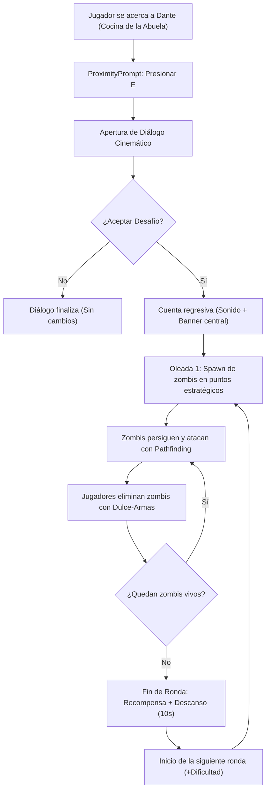

# Sistema de Hordas de Zombis (Estilo Call of Duty Zombies)

Este documento detalla la arquitectura, el diseño y los flujos de ejecución del modo de supervivencia de hordas zombis implementado en **El Patrón del Dulce**.

---

## 1. Visión General del Evento

Inspirado en la clásica experiencia de supervivencia por rondas de **Call of Duty Zombies**, los jugadores pueden activar un evento de horda interactuando con el NPC **Dante** dentro de la **Cocina de la Abuela**.

### Flujo de Juego

---

## 2. Componentes del Sistema

### 2.1. NPC Dante (`HordeService.luau` & `DanteController.luau`)
- **Ubicación Fija:** Dentro de la Cocina de la Abuela en las coordenadas `(85, 63, -70)`.
- **Apariencia:** Humanoide estilizado R6 con ropa urbana oscura, abrigo largo, accesorios procedurales y soporte para cabeza clásica.
- **Interacción:** `ProximityPrompt` configurado con tecla `E`, distancia de activación de 10 studs y detección de línea de visión configurable.
- **Animación & Cinemática:**
  - Orientación y mirada dinámica hacia el jugador durante la conversación.
  - Interfaz de conversación estilizada con confirmación explícita mediante los botones **COMENZAR HORDA** o **AHORA NO**.
  - Si el jugador se aleja más de 16 studs de Dante, el diálogo se cierra automáticamente por seguridad.

### 2.2. Gestor de Oleadas (`WaveManager.luau`)
Centraliza las fórmulas de progresión matemática para garantizar un incremento de dificultad justo y escalable:

$$\text{Zombis Totales} = \text{base} + (\text{oleada} \times \text{incremento})$$

| Oleada | Cantidad de Zombis | Multiplicador de Vida | Velocidad de Movimiento | Intervalo de Ataque |
|---|---:|---:|---:|---:|
| **1** | 5 | 1.0x (80 HP) | 10.0 (Lenta) | 1.35 s |
| **2** | 8 | 1.1x (88 HP) | 10.0 (Lenta) | 1.30 s |
| **3** | 12 | 1.25x (100 HP) | 13.0 (Media) | 1.20 s |
| **4** | 16 | 1.45x (116 HP) | 14.5 (Media) | 1.15 s |
| **5** | 20 | 1.70x (136 HP) | 16.0 (Rápida) | 1.10 s |
| **6+** | $+4$ por ronda | $+15\%$ por ronda | $16.0 + 0.3 \times (\text{oleada} - 5)$ | 1.00 s |

### 2.3. Inteligencia Artificial de los Zombis (`ZombieAI.luau`)
Cada zombi opera bajo una máquina de estados finita:

- **`Idle`:** Patrullaje corto o espera cuando no hay jugadores detectados.
- **`Detecting`:** Escaneo de objetivos en un radio de 120 studs mediante comprobación de distancia y estado vivo del Humanoid.
- **`Chasing`:** Cálculo de trayectorias mediante `PathfindingService` con parámetros de agente:
  - `AgentRadius`: 2.5 studs.
  - `AgentHeight`: 5.0 studs.
  - `AgentCanJump`: `true`.
  - Recálculo inteligente de rutas cada 0.45s o cuando el jugador cambia significativamente de posición para optimizar rendimiento.
- **`Attacking`:** Al estar a menos de 4.8 studs del objetivo:
  - Reduce o detiene el movimiento.
  - Reproduce animación de golpe cuerpo a cuerpo.
  - Aplica daño validado en el servidor tras una ventana de impacto de 0.28 segundos.
- **`Stunned`:** Breve desaceleración o retroceso al recibir impactos de bala.
- **`Dead`:** Detiene la IA, desactiva colisiones corporales, otorga pesos/recompensas y reproduce la animación de caída antes de limpiar el modelo (`Debris`).

### 2.4. Animaciones y Fallbacks Procedurales (`ZombieAnimationController.luau`)
Para garantizar compatibilidad absoluta tanto si existen animaciones oficiales de Roblox cargadas como si el asset aún no está publicado:
- Si el modelo cuenta con `AnimationTrack` válidos para `Idle`, `Run`, `Attack` y `Death`, se cargan y reproducen mediante el `Animator`.
- Si las animaciones externas no están disponibles, el controlador activa **animaciones procedurales basadas en Motor6D**:
  - Oscilación de extremidades (*walk cycle* sinusoidal).
  - Inclinación corporal hacia adelante al correr (*encorvado zombi*).
  - Inclinación espasmódica de cabeza y cuello.
  - Arco de impacto de los brazos al atacar.
  - Desplome físico al morir.

### 2.5. Variantes de Zombis y Zombi de Lava / Fuego
- **Caminante Podrido (Oleada 1+):** Zombi estándar de movimiento moderado.
- **Azucarado Tóxico (Oleada 1+):** Infectado con cristales de azúcar ácida de mayor velocidad.
- **Corredor Rabioso (Oleada 2+):** Rápido y agresivo, embiste velozmente a los sobrevivientes.
- **Bruto Caramelo (Oleada 3+):** Tanque pesado con el doble de vida y daño demoledor.
- **🔥 Zombi de Lava / Fuego (`ZombiLava` - Oleada 3+):**
  - Basado en el modelo original del juego con textura de lava (`rbxassetid://102118326`) en las 6 caras de cada extremidad.
  - Emisores de partículas de `Fire` activos en cabeza, torso, brazos y piernas (`Heat = 9`, `Size = 4.5`, tonalidad fuego y lava).
  - Luz ardiente de área (`PointLight`) que ilumina su alrededor con aura naranja.
  - **Ataque ígneo:** Al golpear a un jugador, le aplica un efecto temporal de quemadura con fuego (`QuemaduraFuegoZombi`).
  - **Muerte explosiva:** Al ser eliminado, sus partículas de fuego se expanden a tamaño 10 antes del despawn.
  - **Aparición:** Se desbloquea a partir de la **Ronda 3** con aparición temprana garantizada y banner ardiente en el HUD.

### 2.6. Puntos de Aparición y Mapa (`UtilidadesMapaHorda.luau`)
- Crea y gestiona 8 puntos de aparición estratégicos distribuidos en zonas accesibles alrededor de la plaza y los callejones cercanos a la cocina.
- Verificación de no colisión con el jugador ni con geometrías estáticas.
- Spawneo secuencial escalonado para evitar tirones de rendimiento en el servidor.

---

## 3. Integración con el Sistema de Combate (`SistemaArmas.server.luau`)

- Cuando un jugador dispara con una Dulce-Arma (Chicle-Pistola, Escopeta de Caramelo, etc.), el servidor valida la trayectoria del raycast.
- Si el rayo impacta en una parte de un zombi:
  - Detecta la etiqueta `CollectionService` o atributo `EsZombi`.
  - Aplica el daño correspondiente.
  - Notifica a la IA para atraer la atención del zombi hacia el tirador.
  - Al morir el zombi, otorga pesos y fama en el perfil del jugador (`GestorDatos`).

---

## 4. Hoja de Ruta para Futuras Expansiones

1. **Ventajas / Perks (Bebidas de Caramelo):**
   - *Juggernog*: Aumenta la salud del jugador de 100 a 250.
   - *Speed Cola*: Recarga 50% más rápida para las armas de dulce.
   - *Double Tap*: Disparo doble de proyectiles de caramelo.
   - *Quick Revive*: Reanimación acelerada en cooperativo.
2. **Caja Misteriosa de Dulces:**
   - Ubicación aleatoria en el mapa con tiradas de armas legendarias.
3. **Máquina de Azúcar Concentrado (Pack-a-Punch):**
   - Mejora de nivel para cualquier dulce-arma, duplicando el daño y cambiando el color del proyectil y efectos de sonido.
4. **Zombis Especiales y Jefes:**
   - *Zombi Caries Ácida:* Explota al morir soltando un charco corrosivo.
   - *El Inspector Dental (Boss):* Aparece cada 5 oleadas con armadura pesada y ataques de área.
