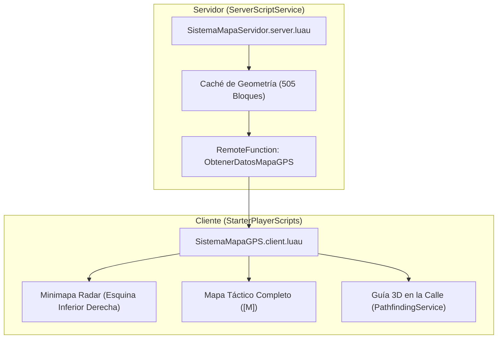

# 🗺️ Sistema de Cartografía, Minimapa Adaptable y Navegación GPS

El sistema de cartografía y navegación de **El Patrón del Dulce** ofrece una experiencia integral de orientación urbana y navegación táctica en tiempo real, integrando minimapa dinámico, mapa panorámico interactivo, brújula y trazado de rutas 3D sobre las calles.

---

## 🏗️ Arquitectura del Sistema

---

## 📡 1. Servidor Cartográfico Autoritativo (`SistemaMapaServidor.server.luau`)

Debido a que el juego utiliza `StreamingEnabled`, los clientes no tienen cargada la geometría de toda la ciudad de forma simultánea. Para resolver esto:

1. **Escaneo Centralizado:** Al iniciar, el servidor escanea la jerarquía física de `Workspace.Mapa.Ciudad_Cuadricula` (81 vías, manzanas, 152 parques, 48 edificios modernos, 144 casas coloniales y zonas exteriores).
2. **Normalización Cartográfica:** Convierte las partes tridimensionales en una lista serializable de bloques 2D (`X`, `Z`, `W`, `D`, `Tipo`, `Color`).
3. **Colores Realistas de Alto Contraste:**
   - **Vías y Carreteras:** Asfalto nítido (`RGB 58, 64, 76`) con línea vial dorada (`RGB 255, 218, 60`).
   - **Lotes y Césped:** Verde pradera vivo (`RGB 86, 148, 80`).
   - **Parques:** Verde forestal brillante (`RGB 68, 168, 76`).
   - **Edificios:** Arquitectura luminosa contrastada (`RGB 218, 226, 238`).
   - **Casas Residenciales:** Techos coloniales terracota/ladrillo (`RGB 214, 158, 122`).
   - **Zonas y Hospital:** Distintivos claros con nombres en el mapa.
4. **Distribución de Red:** Entrega los datos mediante la `RemoteFunction` `ObtenerDatosMapaGPS` con caché pre-calentada para consumo instantáneo en cliente.

---

## 🧭 2. Minimapa Radar en Tiempo Real y Adaptabilidad (`SistemaMapaGPS.client.luau`)

El minimapa situado en la esquina inferior derecha permite al jugador monitorear su entorno inmediato con actualización en cada fotograma (`RenderStepped`).

### Características Principales

- **Orientación Dinámica:** La flecha del jugador rota de acuerdo al `yaw` (giro de cámara/personaje).
- **Brújula Norte:** Indicador flotante estilizado que apunta siempre al norte magnético del mapa.
- **Optimización por Culling (`radioMax`):** Solo calcula y actualiza los bloques geométricos dentro del radio de alcance visual, garantizando 60+ FPS sin consumo innecesario de GPU.
- **Iconos de Puntos de Interés (POIs):** Muestra las tiendas, cocinas, hospitales y zonas de horda cercanas.

### Personalización de Tamaño según el Jugador

El minimapa no es estático; el jugador puede acomodarlo a su gusto mediante:

1. **Presets Rápidos de 1 Clic (`P`, `M`, `G`):**
   - **`[P]` Pequeño (`165 × 185 px`):** Tamaño ultracompacto para despejar la pantalla. La barra se sintetiza automáticamente a `[M]` para máxima elegancia.
   - **`[M]` Mediano (`220 × 248 px`):** Tamaño estándar equilibrado con el botón completo `[M] Mapa`.
   - **`[G]` Grande (`320 × 360 px`):** Modo táctico panorámico que abarca muchas más cuadras a la redonda.
   - **Animación con `TweenService`:** Transiciones suaves (`0.24 s, Quad`) con retroalimentación visual cian en el botón activo.

2. **Tirador Interactivo de Ajuste Libre (`⤢`):**
   - Situado en la barra superior a la izquierda.
   - Permite hacer clic y arrastrar con el ratón (o deslizar en pantallas táctiles) para redimensionar el panel con total libertad entre `150 px` y `440 px` de ancho.
   - Actualiza automáticamente los botones e interfaz según la escala alcanzada.

3. **Controles de Zoom In / Zoom Out (`+` y `−`):**
   - Botones discretos en la esquina inferior izquierda del radar para acercar o alejar el campo de visión del radar (`zoom de 0.20 a 0.85 studs`).

4. **Acoplamiento de la Píldora GPS (`PillEstadoGPS`):**
   - Cuando hay una ruta activa, la tarjeta de destino y distancia en metros se acopla dinámicamente justo encima del minimapa, recalculando su posición y tamaño según la escala seleccionada.

---

## 🗺️ 3. Mapa Táctico Panorámico (`[M]`)

Al pulsar la tecla **M** o presionar el botón `[M] Mapa`, se despliega una interfaz a pantalla completa:

- **Lienzo Navegable:** Arrastre con clic izquierdo para desplazamiento (pan) y rueda del ratón para zoom fluido.
- **Panel Lateral de Navegación:**
  - Buscador predictivo en tiempo real por texto.
  - Filtros por categorías: *Todos, Cocinas, Tiendas, Horda / Armas, Zonas Clave, Escondites*.
  - Tarjetas de puntos de interés con distancia calculada en vivo y botón directo `Ir`.
- **Marcadores Personalizados:** Clic en cualquier punto del lienzo para fijar un marcador GPS temporal personalizado.

---

## 🛣️ 4. Guía y Trazado GPS 3D en la Calle

Al activar un destino:
1. `PathfindingService` calcula la ruta óptima por las aceras y calzadas vehiculares.
2. Se genera una secuencia visual de vigas/segmentos de neón cian brillante (`Color3.fromRGB(0, 225, 255)`) directamente sobre el pavimento.
3. El sistema recalcula la ruta dinámicamente si el jugador se desvía.
4. Al llegar a menos de `22 studs` del objetivo, emite un sonido de confirmación, despliega un banner de llegada y desactiva la ruta de forma limpia.
